<p align="center">
  
</p>

<h1 align="center">Farhan Shahriar · Portfolio</h1>

<p align="center">
  <strong>A responsive portfolio for the story behind the work.</strong><br/>
  A static HTML, CSS and JavaScript portfolio presenting Farhan Shahriar’s profile, education, experience, skills and contact sections.
</p>

<p align="center">
  <a href="https://developer.mozilla.org/en-US/docs/Web/HTML"></a>
  <a href="https://developer.mozilla.org/en-US/docs/Web/CSS"></a>
  <a href="https://developer.mozilla.org/en-US/docs/Web/JavaScript"></a>
  <a href="https://gsap.com/"></a>
</p>

<p align="center">
  <a href="#project-details">Overview</a> · <a href="#project-setup">Get started</a> · <a href="#creator-developer-maintainer">Creator</a>
</p>

---

<a id="project-details"></a>
## Overview

This is a static front-end portfolio implemented with HTML, CSS, and vanilla JavaScript. The page uses GSAP/ScrollTrigger for animation and VanillaTilt for pointer-driven tilt effects, loaded from external CDNs.

## Technology

| Layer | Technology |
|---|---|
| Structure | HTML5 |
| Styling | CSS3 |
| Interactions | JavaScript |
| Animation | GSAP 3.12.5 and ScrollTrigger |
| UI effect | VanillaTilt |
| Fonts | Google Fonts |

<a id="project-setup"></a>
## Run locally

Clone the repository, then open the page:

```bash
git clone https://github.com/tracolerd/Farhan-Shahriar-s-Portfolio.git
cd Farhan-Shahriar-s-Portfolio
```

Open `Farhan_Portfolio/index.html` in a browser. For best results, run a local static server from the repository root and navigate to `/Farhan_Portfolio/`. The current project does not define a Node.js build step.

## Project structure

```text
.
├── Farhan_Portfolio/
│   ├── index.html
│   ├── style.css
│   ├── script.js
│   └── farhan-suit.png
└── LICENSE
```

## Status and attribution

This website presents Farhan Shahriar’s profile. Website design, front-end implementation, and repository maintenance are by [Nurul Faiyaz](https://github.com/tracolerd). External CDN assets require an internet connection.
---

---

## Creator, Developer & Maintainer

**Created, designed, developed, documented, and maintained by [Nurul Faiyaz](https://github.com/tracolerd).**

This website presents Farhan Shahriar. The portfolio implementation, visual design, repository documentation and ongoing maintenance are by Nurul Faiyaz.

<p align="center">
  <a href="https://www.facebook.com/faiyaz.888"></a>
  <a href="https://www.instagram.com/tracolerd"></a>
  <a href="https://www.linkedin.com/in/faiyaz-xyz"></a>
  <a href="https://x.com/faiyaz_explores"></a>
  <a href="https://github.com/tracolerd"></a>
  <a href="mailto:scrollfaiyaz@gmail.com"></a>
  <a href="https://nurul-faiyaz.netlify.app/"></a>
</p>

<p align="center">
  <a href="https://www.facebook.com/faiyaz.888">Facebook</a> ·
  <a href="https://www.instagram.com/tracolerd">Instagram</a> ·
  <a href="https://www.linkedin.com/in/faiyaz-xyz">LinkedIn</a> ·
  <a href="https://x.com/faiyaz_explores">X / Twitter</a> ·
  <a href="https://github.com/tracolerd">GitHub</a> ·
  <a href="mailto:scrollfaiyaz@gmail.com">Email</a> ·
  <a href="https://nurul-faiyaz.netlify.app/">Website</a>
</p>

## License

See [LICENSE](LICENSE) for the license terms.
